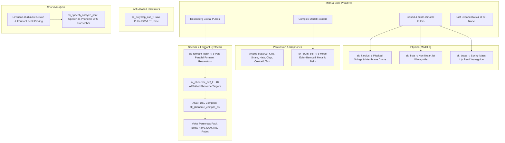

# sk_dsp: High-Performance C99 DSP Toolkit Reference

`sk_dsp.h` is a self-contained, dependency-free, single-file C99 digital signal processing library embedded within `sk3`. It provides mathematically rigorous physical modeling, classic analog synthesis, anti-aliased oscillators, historic formant speech synthesis, modal idiophone percussion, and speech analysis.

- **Header Location**: [`src/sk_dsp.h`](file:///home/stewartj/book/sk3/src/sk_dsp.h)
- **Mirror**: [`src/vendor/ksynth/sk_dsp.h`](file:///home/stewartj/book/sk3/src/vendor/ksynth/sk_dsp.h)
- **License**: MIT License (Copyright © 2026 Joseph Ellis Stewart / Octetta)
- **Dependencies**: C standard library only (`<math.h>`, `<stdint.h>`, `<string.h>`, `<stdlib.h>`, `<stdio.h>`). Zero external audio libraries, zero Python runtime dependencies.

---

## Architecture & Module Overview



---

## 1. Physical Modeling Engines

### A. Extended Karplus-Strong Plucked String (`sk_karplus_t`)

Implements physical digital waveguide string synthesis with:
1. **1st-Order Allpass Fractional Delay**: Solves the pitch quantization error inherent to integer buffer delays without introducing artificial high-frequency damping ($|A(z)| = 1.0$).
2. **Dual-Parameter Excitation**: Pick position comb filter $(x[n] - x[n - D_{\text{pick}}])$ controls harmonic timbre (plucking close to bridge vs. middle) and strike brightness lowpass.
3. **Loss Dynamics**: 1-pole lowpass feedback damping modeling string stiffness and internal dissipation.

```c
sk_karplus_t string;
sk_karplus_init(&string, 48000.0f);
sk_karplus_pluck(&string, 440.0f, 0.85f, 0.20f, 0.60f, NULL);
float sample = sk_karplus_step(&string);
```

### B. Karplus-Strong Physical Drum (`sk_karplus_strike_drum`)
Reconfigures the physical waveguide for 2D circular membrane percussion:
* Rapid non-linear pitch drop on impact ($f[n] = f_0 \cdot (1 + \alpha e^{-t/\tau})$).
* Phase-inverting loop filter ($g < 0$) generating dense inharmonic Bessel zero spectra.

---

### C. Non-Linear Acoustic Jet Flute (`sk_flute_t`)

Physical waveguide modeling based on the McIntyre-Schumacher-Woodhouse (MSW) jet-drive formulation:
* **Jet-Delay Waveguide**: Simulates air jet transit from lip aperture to embouchure labium edge.
* **Non-Linear Sigmoid Jet Drive**: Cubic polynomial saturation ($f(x) = x - x^3$) creating vortex shedding across the labium.
* **Reflection Bore Loop**: Resonant cylindrical acoustic tube with end-correction lowpass filter.
* **Air Jet Turbulence**: Micro-stochastic noise injection modulated by breath pressure.

```c
sk_flute_t flute;
sk_flute_init(&flute, 48000.0f);
sk_flute_set_freq(&flute, 523.25f); /* C5 */
sk_flute_set_pressure(&flute, 0.75f);
float s = sk_flute_step(&flute);
```

---

### D. Spring-Mass Lip-Reed Brass (`sk_brass_t`)

Models acoustic brass instruments (trumpet, trombone, horn):
* **Lip Reed Oscillator**: 1-mass mechanical oscillator driven by player's embouchure muscle tension and mouth pressure $P_m$.
* **Bernoulli Flow Coupling**: Dynamic aperture volume flow governed by Bernoulli's pressure differential.
* **Downstream Bore Waveguide**: Reflection delay line with bell flare acoustic radiation filter.
* **Non-linear Brassiness Waveshaping**: Models finite-amplitude acoustic shock wave steepening in cylindrical leadpipes at high dynamic levels.

```c
sk_brass_t brass;
sk_brass_init(&brass, 48000.0f);
sk_brass_set_freq(&brass, 261.63f); /* Middle C */
sk_brass_set_pressure(&brass, 0.80f);
brass.brassiness = 0.65f;
float s = sk_brass_step(&brass);
```

---

## 2. Anti-Aliased PolyBLEP Oscillators (`sk_polyblep_osc_t`)

Standard naive digital waveforms (sawtooth, square/pulse) introduce infinite harmonic series that fold over the Nyquist frequency, causing audible digital aliasing distortion. `sk_polyblep_osc_t` applies 2nd-order Polynomial Band-Limited Step (PolyBLEP) residual corrections:

$$\text{BLEP}(t) = \begin{cases} 2t - t^2 - 1 & 0 \le t < 1 \\ t^2 + 2t + 1 & -1 < t < 0 \\ 0 & \text{otherwise} \end{cases}$$

* **Supported Waveforms**:
  - `SK_POLYBLEP_SAW`: Anti-aliased ramp wave with sharp analog cut.
  - `SK_POLYBLEP_PULSE`: Continuous pulse-width modulation (PWM) from 1% to 99% without aliasing artifacts.
  - `SK_POLYBLEP_TRI`: Integrated PolyBLEP triangle wave.
  - `SK_POLYBLEP_SINE`: Pure trigonometric sine wave.

```c
sk_polyblep_osc_t osc;
sk_polyblep_osc_init(&osc, 48000.0f);
osc.wave = SK_POLYBLEP_SAW;
sk_polyblep_osc_set_freq(&osc, 440.0f);
float sample = sk_polyblep_osc_step(&osc);
```

---

## 3. Real-Time Percussion Synthesizers

### A. Classic Analog Drum Voices (808 / 909 Emulation)
* **`sk_drum_kick_t`**: Bridged T-network resonator, steep exponential pitch glide (150 Hz $\to$ 45 Hz), punch transient generator, and cubic soft-saturation.
* **`sk_drum_snare_t`**: Dual resonant body oscillators (180 Hz & 330 Hz) blended with highpass-filtered pink noise burst.
* **`sk_drum_hat_t`**: 6-oscillator inharmonic square wave cluster (245, 306, 368, 411, 540, 800 Hz) into a bandpass resonant filter (7 kHz, Q=4.5) with open/choke envelope control.
* **`sk_drum_clap_t`**: Re-triggering multi-strike burst generator (4 micro-bursts 10ms apart) into highpass reverb tail.
* **`sk_drum_cowbell_t`**: Dual detuned square waves (540 Hz & 800 Hz) mixed into a 2.7 kHz resonant bandpass filter.
* **`sk_drum_tom_t`**: Tuned cylindrical shell drum with dynamic pitch droop and strike transient click.

---

### B. Modal Metallic Idiophones (`sk_drum_bell_t`)

Struck metallic solids (church bells, chimes, singing bowls) do not pitch-drop and do not vibrate at drum Bessel zeros; their acoustics are governed by Euler-Bernoulli beam and shell mechanics (inharmonic quadratic eigenmodes):

$$f_n = f_0 \cdot \mu_n, \quad \tau_n = \tau_0 \cdot \gamma_n$$

Implemented using 6 complex modal phasors (`sk_rotator_t`) with striking impact bandpass filtering:

| Preset | Acoustic Character | Mode Frequency Ratios |
| :--- | :--- | :--- |
| `SK_BELL_CHURCH` | Cast bronze church bell | 0.50 (Hum), 1.00 (Prime), 1.19 (Tierce), 1.50 (Quint), 2.00 (Nominal), 2.51 (Decim) |
| `SK_BELL_TUBULAR` | Orchestral tubular chime | 1.00, 2.756, 5.404, 8.933, 13.345 |
| `SK_BELL_VIBE` | Vibraphone / Glockenspiel bar | 1.00, 3.984, 9.24, 15.68 |
| `SK_BELL_TIBETAN` | Tibetan singing bowl | Beating modal doublet pairs (1.000, 1.005, 2.710, 2.720) with long decay |
| `SK_BELL_AGOGO` | Pitched Latin metal bell | 1.00, 2.45, 4.12, 6.78 |

```c
sk_drum_bell_t bell;
sk_drum_bell_init(&bell, 48000.0f, SK_BELL_CHURCH, 261.63f);
sk_drum_bell_trigger(&bell, 0.90f);
float s = sk_drum_bell_step(&bell);
```

---

## 4. Historic Speech & Phoneme Synthesis

### A. Acoustic Formant Engine (`sk_formant_bank_t`)
* **Glottal Excitation**: Polynomial Rosenberg glottal flow wave ($g(t) = 3t^2 - 2t^3$) with cycle-to-cycle micro-jitter and natural vocal vibrato.
* **5-Pole Resonator Bank**: Parallel constant 0 dB peak gain bandpass resonators ($F_1, F_2, F_3, F_4, F_5$).
* **Lip Radiation Acoustic Tilt**: High-frequency pre-emphasis filter ($y[n] = x[n] - 0.72x[n-1]$), adding +6 dB/octave presence above 2 kHz.
* **Aspiration & Plosive Injection**: Immediate transient burst injection for stop consonants (P, T, K, B, D, G) and high-pass presence shelf for sibilants (S, Z, SH).

### B. ASCII Speech DSL Specification
Compiled directly via `sk_phoneme_compile_dsl()`:
```
[PHONEME:duration_ms@pitch_hz>target_pitch_hz~]
```
- `PHONEME`: Any standard ARPAbet code (`AA`, `IY`, `UW`, `S`, `T`, `K`, `M`, etc.) or `_` (pause).
- `:duration`: Steady-state duration in milliseconds.
- `@pitch`: Initial fundamental frequency $F_0$ in Hz.
- `>target`: Linear pitch inflection glissando (wrist-bar inflection).
- `~`: Enables expressive vocal vibrato ($\pm 4\text{ Hz}$ at 5.5 Hz).

Example DSL string:
```text
[HH:70@115 EH1:110@130>138 L:80@135 OW1:200@115>95] [_:200] [W:70 ER1:140@120 L:80 D:60]
```

### C. Voice Persona Emulation
Acoustic vocal tract configurations matching landmark historical speech synthesizers:
* **Perfect Paul**: Classic DECtalk male voice ($F_0 = 120\text{ Hz}$).
* **Beautiful Betty**: DECtalk female voice ($F_0 = 210\text{ Hz}$, bright $F_1/F_2$, aspirated glottis).
* **Huge Harry**: Deep resonant bass male ($F_0 = 85\text{ Hz}$).
* **SAM (1982 Commodore 64)**: Recessed formants, prominent throat buzz, and robotic cadence.
* **Kit the Kid**: Elevated pitch ($F_0 = 260\text{ Hz}$) with reduced vocal tract length.
* **Robot Monotone**: Fixed monotone pitch with zero jitter.

---

## 5. Sound Analysis: Speech-to-Phoneme Transcriber

`sk_speech_analyze_pcm()` transcribes raw mono PCM audio into valid Skode Speech DSL strings in pure C:

```c
int sk_speech_analyze_pcm(const float *pcm, int num_samples, float sample_rate,
                          char *out_dsl, int max_dsl_len);
```

### Acoustic Processing Pipeline
1. **Decimation & Pre-emphasis**: Integer 3:1 decimation from 48 kHz to 16 kHz with pre-emphasis ($y[n] = x[n] - 0.95x[n-1]$).
2. **Windowed Framing**: 25 ms Hamming windows with 10 ms hop interval.
3. **Short-Time RMS & ZCR**: Silence detection and voiced/unvoiced fricative thresholding.
4. **Autocorrelation Pitch Estimation**: High-resolution $F_0$ detection in $[70, 350]\text{ Hz}$.
5. **10th-Order Levinson-Durbin LPC Recursion**: Computes all-pole vocal tract transfer function $A(z) = 1 + \sum_{k=1}^{10} a_k z^{-k}$.
6. **Formant Peak Extraction**: Resolves $F_1, F_2, F_3$ resonant spectral envelope peaks.
7. **Phonetic Codebook Classifier**: Maps observed formants and voicing flags to the nearest ARPAbet token, merging temporal frames into run-length compressed DSL expressions.

---

## 6. Verification & Audio Demonstration Targets

Run all DSP audio demos via:
```bash
make dsp-demos
```

Generated audio outputs in repository root:
* `pluck_demo.wav`: Karplus-Strong string pluck arpeggio.
* `percussion_demo.wav`: Analog 808/909 drum kit + Karplus membrane + 5 modal bell presets (Church, Tubular, Vibraphone, Tibetan, Agogo) + hybrid groove.
* `wind_brass_demo.wav`: Physical flute and brass acoustic models.
* `polyblep_demo.wav`: Anti-aliased PolyBLEP sweeps vs. naive saw/PWM.
* `vowel_demo.wav`: Canonical vowels and Rosenberg glottal morphing.
* `phoneme_demo.wav`: Full 40-phoneme inventory catalog.
* `speech_demo.wav`: Historic speech synthesis showcase (Pedro the Voder, IBM 7094 Daisy Bell, Kraftwerk).
* `voices_demo.wav`: Voice persona comparison across the same phrase.

Automated unit tests are verified via `ctest` in `tests/dsp_math_tests.c` (over 398,000 assertions passed).
