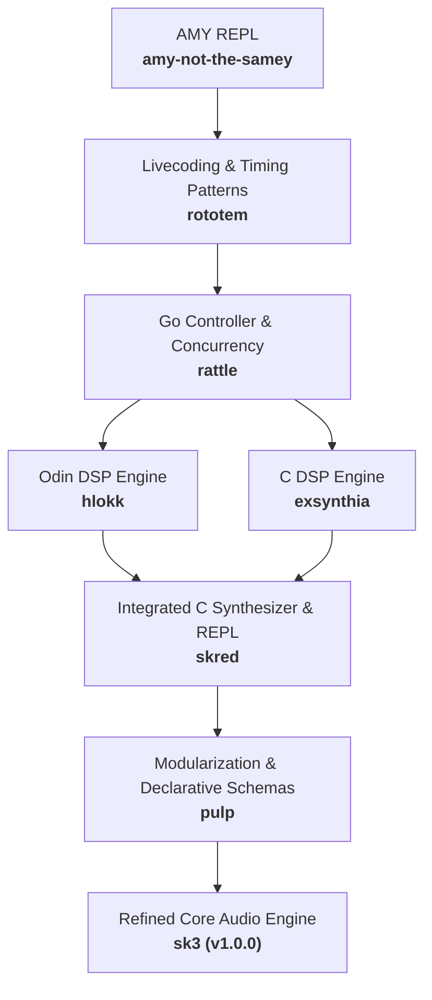

# Evolution & History of sk3

The architecture, language design, and synthesis engine of `sk3` did not emerge overnight. They represent the culmination of a multi-year evolutionary journey of experiments across languages, timing models, wire protocols, and custom audio engines developed by **Joseph Ellis Stewart / [Octetta](https://github.com/octetta)**.

This document traces the historical lineage and milestones that led to `sk3`.

---

## 1. Interactive Wire Protocols: [amy-not-the-samey](https://github.com/octetta/amy-not-the-samey)

- **Repository**: [https://github.com/octetta/amy-not-the-samey](https://github.com/octetta/amy-not-the-samey)
- **Focus**: Interactive REPL and command interface for the AMY synthesizer.

The journey began with writing an interactive REPL for the [AMY](https://github.com/shorepine/amy) synthesizer engine. AMY demonstrated the elegance of controlling synthesis parameters via compact ASCII wire commands (`v0w1f440l1`). Having previously contributed to AMY by replacing PortAudio with `miniaudio` for desktop targets, Joseph Stewart built `amy-not-the-samey` to explore immediate, tactile feedback loops, making synthesis interactive and command-line driven rather than buried behind complex GUI knobs or rigid config files.

*Key Lesson*: Compact ASCII command streams provide an extraordinarily fast, human-playable interface for sound design and live performance, and single-header libraries like `miniaudio` provide unbeatable cross-platform backend simplicity.

---

## 2. Timing, Scheduling & Livecoding Patterns: [rototem](https://github.com/octetta/rototem)

- **Repository**: [https://github.com/octetta/rototem](https://github.com/octetta/rototem)
- **Focus**: Livecoding REPL, musical timing, and algorithmic pattern generation.

Building on the power of interactive synthesis, `rototem` turned attention to musical time: how to represent rhythm, meter, polyrhythmic patterns, and real-time livecoding transformations without losing synchronization. It experimented with declarative pattern languages, clock scheduling, and interactive live updates during playback.

*Key Lesson*: A sound engine is only as expressive as its temporal control; timing must be rock-solid, deterministic, and live-manipulable.

---

## 3. High-Level Controller Architectures: [rattle](https://github.com/octetta/rattle)

- **Repository**: [https://github.com/octetta/rattle](https://github.com/octetta/rattle)
- **Focus**: Exploring Go as an external controller and sequencer.

`rattle` explored decoupling control logic from audio synthesis. By leveraging Go's lightweight concurrency, channels, and rich tooling, `rattle` investigated how a high-level language could manage tracks, sequencing graphs, event dispatching, and session orchestration while sending control streams to lower-level audio backends.

*Key Lesson*: Separating control event publication from audio rendering clarifies engine architecture, but low-latency determinism ultimately demands minimal IPC overhead and lock-free execution paths.

---

## 4. Custom Synth Engines from Scratch: Odin & C

Before committing to a single language and engine topology, multiple experimental synthesis engines were built from the ground up:

### A. Modern Systems Ergonomics: [hlokk](https://github.com/octetta/hlokk) (Odin)
- **Repository**: [https://github.com/octetta/hlokk](https://github.com/octetta/hlokk)
- **Focus**: Custom DSP primitives, voice allocation, and audio memory structures in Odin.
- Explored how modern systems languages like Odin handle manual memory control, SIMD vectorization, and clean type systems in real-time audio contexts.

### B. Bare-Metal Performance: [exsynthia](https://github.com/octetta/exsynthia) (C)
- **Repository**: [https://github.com/octetta/exsynthia](https://github.com/octetta/exsynthia)
- **Focus**: Pure C audio callbacks, low-level oscillator modeling, and zero-overhead performance.
- Proved the absolute portability and minimal footprint of pure C99 for embedded, desktop, and cross-compilation targets.

*Key Lesson*: Pure C offers unmatched portability, zero runtime overhead, and effortless compilation to WebAssembly, while Odin provided deep insights into clean memory layout and data structures.

---

## 5. The Unified Livecoding Instrument: [skred](https://github.com/octetta/skred)

- **Repository**: [https://github.com/octetta/skred](https://github.com/octetta/skred)
- **Focus**: First complete unification of a C synthesizer engine, wavetable oscillator bank, and interactive Forth-inspired language (`skode`).

`skred` brought the threads together into a single cohesive binary:
- A multi-voice C synthesis engine with resonant filters, envelopes, and single-cycle wavetables.
- **Casio CZ-101 Phase Distortion**: Inspired by the CZ-101 and the breakthrough realization that CZ phase distortion methods could simulate continuous pulse-width modulation (PWM) and duty-cycle control over fixed single-cycle wavetables without multi-frame interpolation.
- The **Skode** domain-specific language: a concise, postfix, dictionary-driven language executing directly against voice state registers without intermediate bytecode compilation.
- Embedded terminal line-editing (`uedit`) and immediate livecoding ergonomics.

*Key Lesson*: The combination of an immediate C audio core and an embedded concatenative language created an extraordinarily responsive instrument.

---

## 6. Modularization & Schema Architecture: [pulp](https://github.com/octetta/pulp)

- **Repository**: [https://github.com/octetta/pulp](https://github.com/octetta/pulp)
- **Focus**: Declarative code generation, schema-driven contracts, lockless IPC, and multi-target builds.

As `skred` grew in capability, `pulp` was created to solve architectural modularity, maintainability, and multi-language interop:
- **Declarative Schemas (`schema/*.def`)**: Introduced `mksynth` and `mkopcodes` code generators, ensuring C structs, offsets, and opcode tables were compiled deterministically from single source-of-truth definitions.
- **Lock-Free Concurrency**: Implemented single-producer/single-consumer ring buffers (`skqueue`) and lockless command pipelines (`control-events.h`).
- **Korg DW-8000 Delay Architecture**: Implemented multi-track stereo delay lines directly influenced by the Korg DW-8000 onboard digital delay, featuring discrete coarse/fine time parameterization, feedback saturation, LFO modulation, and vintage grit bit-depth reduction.
- **Target Agnosticism**: Unified native desktop builds (ALSA, CoreAudio), static/shared C libraries, and browser WebAssembly into a single build pipeline.
- **Companion Ecosystem**: Supported bindings and bridges across higher-level tools (`skode` Gleam library, `skred-web` browser presentations, `mod-to-skode`, and `sid-to-skode`).

*Key Lesson*: Declarative schema generation eliminated entire classes of memory layout bugs across C, WASM, and high-level languages like Gleam.

---

## 7. The Core Culmination: [sk3](https://github.com/octetta/sk3)

- **Repository**: [https://github.com/octetta/sk3](https://github.com/octetta/sk3)
- **Version**: `1.0.0`
- **Focus**: Clean-room distillation of the engine into an ultra-lean, production-grade audio core.

`sk3` represents the refined essence of this entire evolutionary progression:
- Distills the declarative architecture of `pulp` into a clean, standalone foundation.
- Vendors and tightly integrates **[k-synth](https://github.com/octetta/k-synth)** for lightning-fast array math and vector DSP.
- Adopts **Osko** as its official mascot.
- Standardizes on clean semantic versioning, strict backward compatibility, and rock-solid WASM/native dual distribution.
