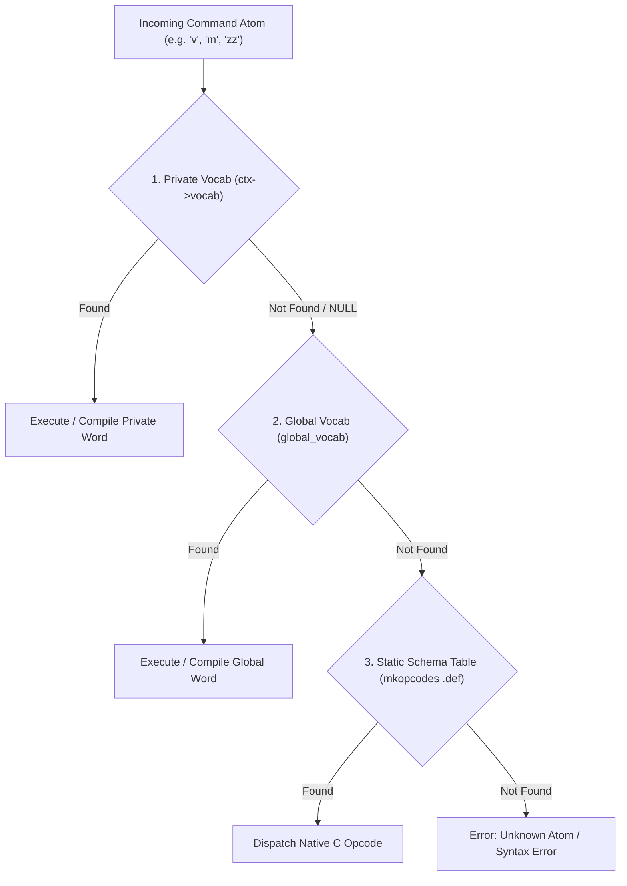
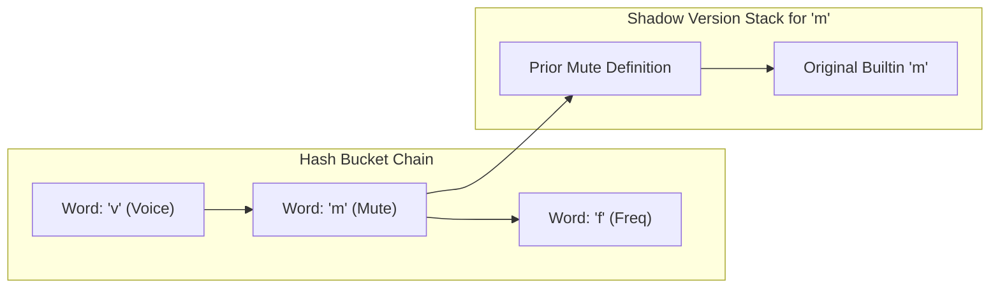

# Forth-Style Command Dictionaries & Vocabularies in Skode

`sk3` incorporates a Forth-inspired dictionary architecture for command dispatch, macro compilation, and namespace isolation. This system decouples command execution from rigid static `switch` statements, enabling dynamic word registration, non-destructive function shadowing, macro promotion, and per-context private vocabularies.

The core implementation lives in [src/skode-dict.h](file:///home/stewartj/book/sk3/src/skode-dict.h) and [src/skode-dict.c](file:///home/stewartj/book/sk3/src/skode-dict.c), with context wiring in [src/skode.c](file:///home/stewartj/book/sk3/src/skode.c).

---

## 1. System Architecture & Search Order

Skode resolves command atoms (1–4 characters packed into 32-bit integer keys like `v---`, `a---`, `d>w-`) using a hierarchical, two-level lookup order mirroring classic Forth `CONTEXT` and `CURRENT` search paths:



### 1. Context Private Vocabulary (`ctx->vocab`)
Each `skode_t` context maintains an optional pointer to a private `skode_vocab_t`.
- When set, private word definitions and overrides take immediate precedence over all global words.
- Destructing the context (`skode_free()`) automatically cleans up and frees the private vocabulary via `skode_dict_vocab_destroy()`.

### 2. Process Global Vocabulary (`skode_dict_global_vocab()`)
A shared, process-wide vocabulary populated at startup by `skode_dict_init()`.
- Houses base words, promoted global macros, and shared utilities.
- Thread-safe for read operations from multiple contexts.

### 3. Static Opcode Table (`skode_dict_gen.h`)
The high-performance, statically generated lookup table compiled by `tools/mkopcodes` from `schema/opcodes/*.def`.
- Ensures zero-allocation, audio-thread-safe real-time dispatch for all native synthesizer primitives.

---

## 2. Word Shadowing & The Version Stack

Unlike simple key-value maps that overwrite previous definitions, Skode's dictionary uses an intrusive **shadow chain** (`word->shadow`) per atom:



When a word is overridden via `skode_dict_override()`:
1. The new `skode_word_t` is spliced directly into the bucket chain in place of the old definition.
2. The old definition becomes reachable via `new_word->shadow`.
3. **Lookup cost remains $O(1)$**: Overriding an atom $N$ times never lengthens the hash bucket chain for unrelated words.
4. **Reversion is non-destructive**: Calling `skode_dict_revert(vocab, atom)` pops the shadow stack and restores the prior word seamlessly.

---

## 3. Promoted Macros

Skode macros defined via bracket syntax `[name] : body ;` are evaluated at definition time:
1. **Safety Analysis**: `compute_macro_safety()` passes the body to the real compiler (`skode_compile_program_ex()`).
2. **Promotion**: If the macro compiles entirely to bounded, real-time-safe scheduler opcodes, `skode_dict_promote_macro(vocab, name, body)` compiles it into an `event_program_t` and registers it directly into `vocab` as a native word.
3. **Zero String Preprocessing**: Once promoted, invoking `name 440` executes the compiled program directly with zero text substitution and zero dynamic allocation.
4. **Introspection**: The command `?m` inspects macro status, reporting `realtime` (promoted) or `immediate` (text-expansion fallback).

---

## 4. C API Quick Reference

### Vocabulary Lifecycle
```c
/* Allocate an empty private vocabulary */
skode_vocab_t *vocab = skode_dict_vocab_create();

/* Assign to a context */
ctx->vocab = vocab;

/* Free vocabulary and all promoted macros allocated inside it */
skode_dict_vocab_destroy(vocab);
ctx->vocab = NULL;
```

### Registration & Overrides
```c
/* Register a new word strictly (fails if atom exists) */
int skode_dict_register(skode_vocab_t *vocab, skode_word_t *word);

/* Override/shadow an existing atom (returns shadowed word) */
skode_word_t *skode_dict_override(skode_vocab_t *vocab, skode_word_t *word);

/* Revert the most recent override for an atom */
skode_word_t *skode_dict_revert(skode_vocab_t *vocab, uint32_t atom);

/* Completely remove an atom and all its shadows */
skode_word_t *skode_dict_remove(skode_vocab_t *vocab, uint32_t atom);
```

### Lookup & Dispatch
```c
/* Two-level search (private_vocab -> global_vocab -> static defs) */
const skode_word_t *skode_dict_lookup(skode_vocab_t *private_vocab, uint32_t atom);

/* Lookup by human-readable string */
const skode_word_t *skode_dict_find_by_name(skode_vocab_t *vocab, const char *name);
```

---

## 5. Practical Usage Patterns

### A. Multi-Client / Multi-Tenant Isolation
When hosting multiple interactive sessions (e.g., local GUI, HTTP POST API, UDP control, Web REPL):
```c
skode_t client_ctx;
skode_init(&client_ctx);

/* Give client its own isolated namespace */
client_ctx.vocab = skode_dict_vocab_create();

/* Client defines custom macros or overrides words */
skode_consume("[lead]: v0 w1 f$$0 a-6 ;", &client_ctx);

/* Tear down safely when connection closes */
skode_free(&client_ctx); // automatically calls skode_dict_vocab_destroy()
```
*Benefits*: Client definitions cannot collide with or corrupt other sessions or the global engine dictionary.

### B. The "Enhance" / Middleware Decorator Pattern
Because `skode_dict_override()` preserves the previous word in `self->shadow`, you can install pre/post hooks or middleware wrappers around built-in words without modifying engine sources:

```c
static int logging_mute_exec(const skode_word_t *self, skode_t *ctx, ands_t *s, double *arg, int argc) {
    ctx->printf(ctx, "# [LOG] Mute word intercepted for voice %d\n", ctx->voice);

    /* Call through to the previous definition */
    if (self->shadow && self->shadow->execute) {
        return self->shadow->execute(self->shadow, ctx, s, arg, argc);
    }
    return 0;
}

void install_mute_hook(skode_vocab_t *vocab) {
    static skode_word_t wrapped_m;
    memset(&wrapped_m, 0, sizeof(wrapped_m));
    wrapped_m.atom = SKODE_DICT_ATOM("m");
    wrapped_m.name = "m";
    wrapped_m.execute = logging_mute_exec;
    skode_dict_override(vocab, &wrapped_m);
}

void uninstall_mute_hook(skode_vocab_t *vocab) {
    skode_dict_revert(vocab, SKODE_DICT_ATOM("m"));
}
```
*(See `skode_dict_install_example_mute_logger()` in [src/skode-dict.c](file:///home/stewartj/book/sk3/src/skode-dict.c) for the reference unit-tested implementation).*

### C. Domain-Specific Musical Dialects & Cue Switching
Vocabularies allow switching musical dialects or cue banks on the fly:
- **Rhythm / Drum Machine Vocab**: Shadow voice commands with dedicated drum words (`bd`, `sd`, `hh`, `cp`).
- **Live Cue Banks**: Each song or cue list can be loaded into a distinct `skode_vocab_t`. Switching songs in a live set simply swaps `ctx->vocab = song_vocab[song_id]`, instantly rebinding song cues without restarting the engine.
- **Tracker Emulation**: Map tracker-style arpeggio tick words or vibrato table invocations into a specialized tracker vocabulary.
